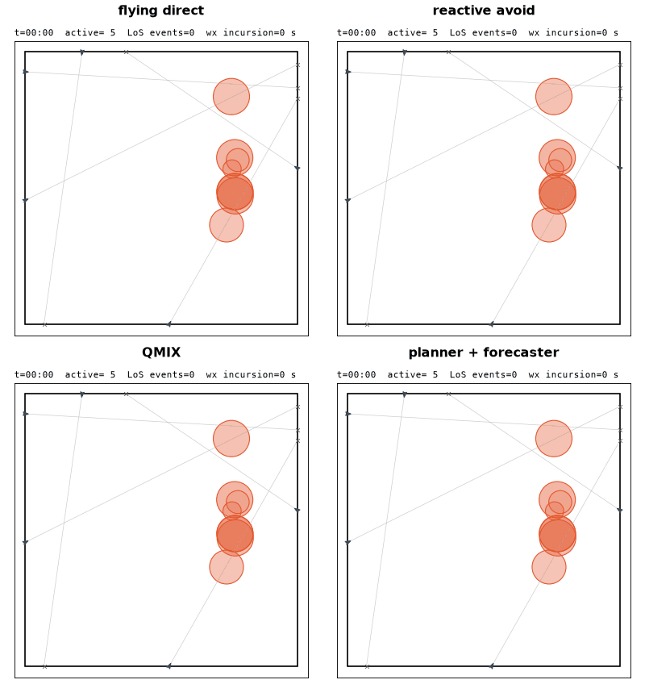
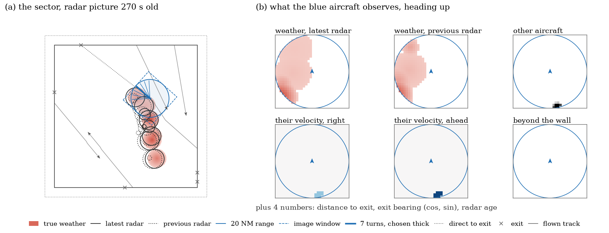

# WxMARL

A batched PyTorch simulator of **multi-aircraft conflict resolution in evolving, partially observed weather-affected airspace**, and the code of the diagnostic study *What Should a World Model Learn? A Diagnostic Study of Multi-Aircraft Conflict Resolution in Evolving Weather-Affected Airspace*.

Aircraft cross a square sector to their exits. They keep separation from each other and avoid weather regions that move, grow and decay. Each aircraft picks a turn every 30 s. The whole simulator state is a set of tensors plus one random generator, so any moment can be copied and rolled forward exactly. The study builds on that: one model-predictive planner (CEM) stays fixed while its predictor changes one component at a time:

- the weather is frozen, extrapolated, tracked, forecast by a small learned model, or exact;
- other aircraft are handled by a coordination rule;
- or everything is learned end to end.

Each predictor is scored at three levels: forecast accuracy, plan ranking and flown outcome. Reactive avoidance and QMIX ([EPyMARL](https://github.com/uoe-agents/epymarl)) serve as reference controllers.

<p align="center"></p>

*One scenario with weather across most routes (class W3, five aircraft), flown by four controllers. Arrows: aircraft with fading tracks. Grey lines: each aircraft's line to its exit (×). Red discs: weather cells, darker = more intense. Flying direct spends 1,245 s in weather and loses separation once. Reactive avoid spends 450 s and QMIX 520 s; their delays are 68 s and 152 s. The planner with the learned forecaster spends 5 s, with 33 s of delay. Rendered by `python -m repro.gifs`.*

## Setup

Dependencies are managed with [uv](https://docs.astral.sh/uv/) (Python 3.11). Torch is the CUDA 12.6 build, which also covers older GPUs such as the V100.

```bash
uv sync                          # .venv with the locked dependencies
bash scripts/setup_epymarl.sh    # EPyMARL into third_party/epymarl at the pinned commit (only for QMIX / MARL training)
uv run pytest                    # CPU, under a minute
```

Prefix the commands below with `uv run`, or activate `.venv` first.

## Reproducing the paper

Every result is a run id in [wm/experiments.py](wm/experiments.py). `repro.run` runs run ids locally, each after the jobs it needs (forecasters before the flights that use them, QMIX before its evaluation). It skips finished jobs and resumes a run from its cached chunks.

```bash
python -m repro.jobs                                   # every job in run order, and what it needs
python -m repro.run all --gpus 0,1 --per-gpu 3 --cpu 4 # everything (about 35 GPU-hours on V100s, mostly E1 and E3)
python -m repro.run E1-tracker E1-forecast-s0          # some jobs, plus whatever they need
python -m repro.run all --mock                         # CPU smoke test of every job at toy sizes
python -m repro.report                                 # results/redesign/report/REPORT.{pdf,md}: every table and figure
python -m repro.trace && python -m repro.figures       # the paper's drawn figures -> results/redesign/paper_figures/
python -m repro.gifs                                   # the animation above -> docs/controllers.gif
```

Each module also runs alone, e.g. `python -m wm.eval E1-tracker device=cuda [a.b=value ...] [--mock]`. Results go to `results/redesign/<package>/<run id>/`, one `metrics.json` per run with one row per scenario.

| Package | Run ids | What it answers |
|---|---|---|
| `01_scenarios` | `SUITE-*` | Route-impact class W0–W3 of every scenario (Table I) |
| `02_forecasters` | `WX-sector-s{0,1,2}`, `WX-local-s0`, `WX-radar-s0`, `WX-heavy-s0` | Trains the weather forecaster: sector radar, 20 NM radar, radar-only targets, heavy weather |
| `03_qmix` | `QMIX-s{0,1,2}` | Trains QMIX (CNN agent on the grid observation) |
| `04_baselines` | `BASE-direct`, `BASE-avoid`, `BASE-qmix-s{0,1,2}` | Flying direct, reactive avoid, QMIX: the validity check |
| `05_rq1_forecasting` | `E1-{frozen,extrap,tracker,perfect,radar}`, `E1-forecast-s{0,1,2}` | **RQ1**: the joint planner with each weather predictor, by route-impact class |
| | `E1-seen`, `E1-perfect-H20` | Diagnostics: the true state of only the cells on the latest picture (births); a 10 min horizon |
| `06_forecast_quality` | `WX-eval` | Overlap of each forecast at 1, 2.5 and 5 min |
| `07_rq2_coordination` | `E3-N{3,5,8}-*` | **RQ2**: with exact weather, simultaneous replanning, assuming others fly direct, fixed order, joint |
| `08_airborne` | `AIR-{forecast,local,tracker}` | Fixed order with weather an aircraft could have, including 20 NM radar |
| `09_attribution` | `DATA-avoid`, `E4-s0`, `E4-s0-fly`, `RANK` | The end-to-end model: plan-ranking agreement τ of every predictor, state error, flights |
| `10_difficulty` | `E5-*` | One weather factor at a time (births, wind, radar age, traffic) and heavy weather |

Pooled results use a balanced 1,024 of the 1,344 screened scenarios (128 / 384 / 384 / 128 in W0–W3; `wm.stats.balanced`). Paired tests are in `wm/stats.py`. QMIX trains for `t_max = 400,000` and is evaluated at its last checkpoint, at about 0.3 M steps.

## Environment

<p align="center"></p>

*(a) The radar pictures lag the true regions. The blue aircraft weighs seven turns over the next 5 min and sees only its 20 NM range. (b) Its grid observation.*

| | |
|---|---|
| Sector | 150 × 150 NM, with a hard wall 10 NM outside the edge |
| Aircraft | `N` per episode (default 5). All start at `t = 0` on the sector edge, at least 10 NM apart and outside weather, with entry and exit on different edges at least 75 NM apart. A flight succeeds within 5 NM of its exit. |
| Kinematics | 225 kt, turns at up to 3°/s, 5 s substeps |
| Separation | 5 NM. A loss of separation (LoS) is any moment two aircraft are closer. |
| Decision step | 30 s. Episodes end when every flight has exited or timed out (2.5 × its direct time), at most 120 steps. |

**Weather.** Each episode has one or two weather systems of up to 16 disc cells in all. A system's centre drifts with an episode-wide wind of 10–30 kt. Each episode draws one family:

| Family | Where new cells appear |
|---|---|
| isolated | within 8 NM of a system centre |
| clustered | within 25 NM of a system centre |
| banded | along a 60–120 NM line across the wind |

A cell's velocity follows the wind plus noise. Its radius grows early in its 40–90 minute life and shrinks late, and its intensity peaks mid-life. New cells appear as a Poisson process. The weather runs for 90 minutes before the episode starts. Severity at a point is `I · max(0, 1 − distance / radius)`. The generator is in Appendix A of the paper and in `core/weather.py`.

`core/impact.py` screens a scenario by how many direct routes enter the 5 NM avoidance envelope around cell edges: W0 = none, W1 = one, W2 = two, W3 = three or more (at N = 5). It also records each route's shortest detour around the moving envelope.

**What an aircraft senses.** Weather comes only from radar pictures, refreshed every 5 minutes, and the aircraft sees the latest picture and the one before. Weather cells and other aircraft are seen within 20 NM. Cell velocity, growth and age are hidden.

**Actions.** 7 turns relative to the current heading: −45°, −30°, −15°, 0°, +15°, +30°, +45°. Speed control can be added through `action.speed_deltas_kt` (off by default).

**Observations** (`obs.mode`):
- `scan`: 38 numbers. For each turn, a 5-minute straight look-ahead gives the closest approach to other aircraft, plus the worst severity and the time to weather on each radar picture. The exit's distance and bearing complete it.
- `grid` (`agent=wx_cnn`): a heading-up 32 × 32 window at 1.25 NM per pixel. It has 6 planes: severity on both pictures, other aircraft, their velocity, and the area beyond the wall. Four numbers are added: exit distance, exit bearing (cos, sin) and radar age.
- Global state for centralized critics and mixers: every aircraft and every cell, hidden variables included.

**Reward**, per aircraft and step (team sum for QMIX and VDN):

| Term | Weight |
|---|---|
| progress toward the exit minus that of flying direct | 1 |
| fraction of the step in loss of separation | 50 |
| mean severity at the aircraft's position | 100 |
| per 30° of turn | 0.3 |
| reaching the exit | 10 |
| timeout | 20 |

Episode metrics: LoS events and time, time and severity in weather, time in the envelope, delay and extra distance against flying direct, completion, and heading changes.

## Training and evaluating MARL controllers

```bash
bash scripts/train.sh qmix 0 grid t_max=400000 agent=wx_cnn buffer_size=500   # algo: iql vdn qmix ia2c ippo maa2c mappo
python scripts/evaluate.py --policy avoid --preset default --episodes 100      # fixed evaluation scenarios, with videos
python scripts/evaluate.py --checkpoint "results/models/<run dir>" --preset default
python scripts/replay.py results/eval/<dir>/episode_0_seed100000.npz          # re-render a saved replay
python scripts/benchmark.py                                                   # env steps per second
```

wandb is off unless `WANDB_MODE=online` (or `offline`) and `WANDB_ENTITY` are set. [configs/epymarl/README.md](configs/epymarl/README.md) lists the EPyMARL settings and where they differ from its defaults.

## Layout

```
env.py, config.py    WxEnv, the batched environment, and its dataclass config; presets in configs/env/
core/                aircraft, weather, traffic, observations, reward, metrics, route-impact screen
baselines/           direct, random, reactive avoid
wm/                  the study: planner (CEM), oracle (predictor levels), forecaster, end-to-end model, evaluation, stats, registry
repro/               reproduces the paper: job table, local runner, report, figures and animation, QMIX training
wrappers/            EPyMARL adapter, launcher, CNN agent; settings in configs/epymarl/
render/, scripts/    replay recording and video; train, evaluate, replay, benchmark
```
